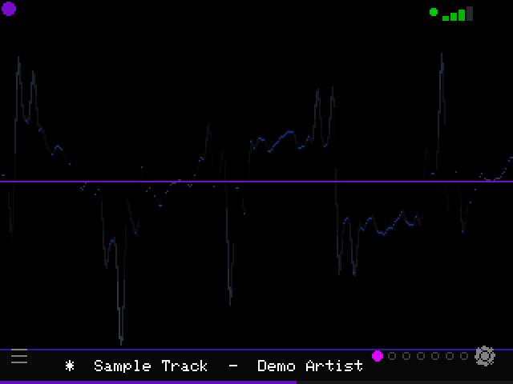
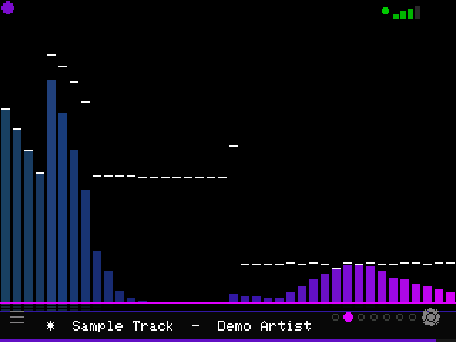
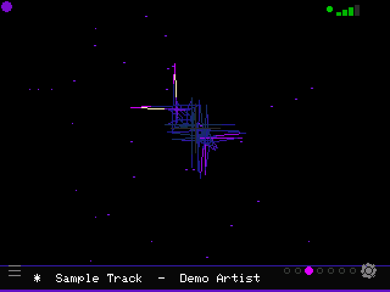
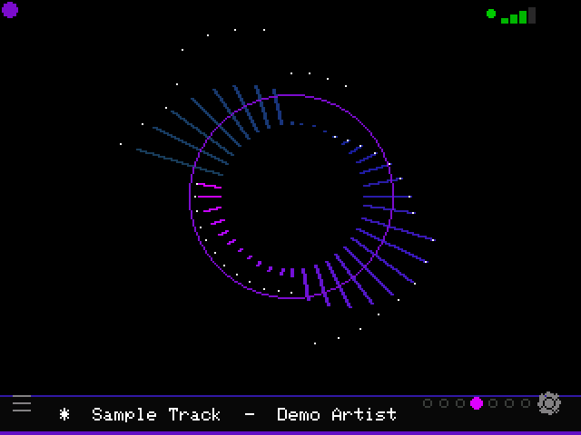
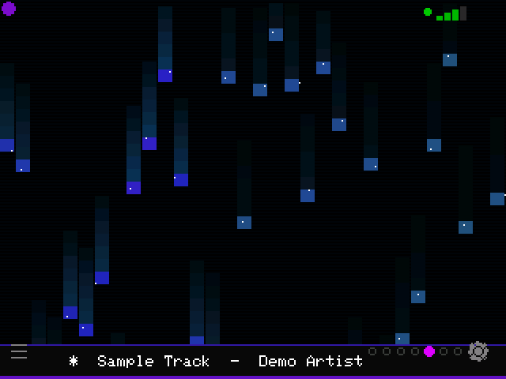
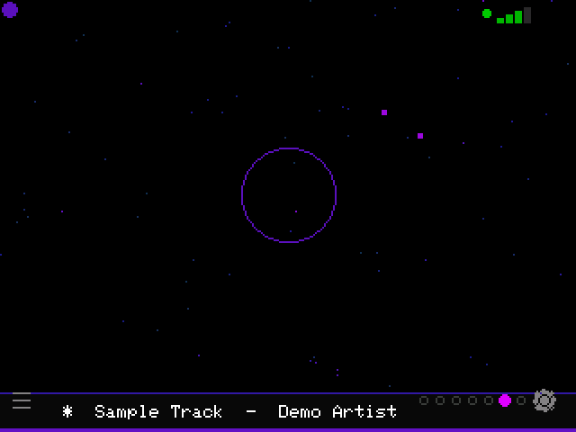
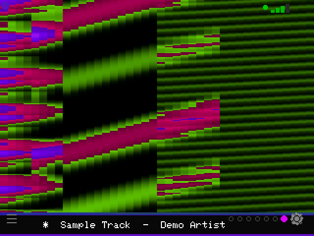

# cyd-spotify-visualizer

**A beat-synced, music-reactive visualizer for the ESP32-2432S028R (Cheap Yellow Display)**  
Connects to Spotify via Wi-Fi and drives 7 real-time visualization modes using live track metadata — BPM, energy, danceability, valence, key, and mode.

*Junior Edition · The Far Edge*

<table>
  <tr>
    <td align="center"><br><sub><b>Waveform</b></sub></td>
    <td align="center"><br><sub><b>Spectrum</b></sub></td>
    <td align="center"><br><sub><b>Scatter</b></sub></td>
  </tr>
  <tr>
    <td align="center"><br><sub><b>Radial Burst</b></sub></td>
    <td align="center"><br><sub><b>Matrix Rain</b></sub></td>
    <td align="center"><br><sub><b>Starfield</b></sub></td>
  </tr>
  <tr>
    <td align="center" colspan="3"><br><sub><b>Waterfall</b></sub></td>
  </tr>
</table>

<sub>Screenshots are renders from a host-side emulator of the CYD display. It runs this sketch's own drawing code with sample track data (124 BPM, G major, energy 0.82, valence 0.70, title "Sample Track - Demo Artist"). They are not photos of the device, and each frame was picked on a beat.</sub>

---

## Features

- **7 Visualization Modes** — Waveform, Spectrum Analyser, Scatter/Lissajous, Radial Burst, Matrix Rain, Starfield, Waterfall
- **Live Spotify Sync** — polls currently-playing track every 3 seconds via Spotify Web API
- **Beat Engine** — derives a beat clock from BPM + track progress timestamp, stays locked even if you skip
- **Musical Colour System** — hue maps to musical key (circle of fifths), palette shifts with valence (sad=cool, happy=warm), saturation driven by major/minor mode
- **Wi-Fi Settings UI** — tap the ⚙ gear icon to open an on-screen QWERTY keyboard and change networks without reflashing
- **NVS Credential Storage** — saved Wi-Fi credentials survive reboots; compiled-in home default as fallback
- **No microphone needed** — spectrum and waveform are synthesized from Spotify audio feature metadata

---

## Hardware

| Component | Notes |
|-----------|-------|
| ESP32-2432S028R (CYD) | ILI9341 320×240 TFT + XPT2046 resistive touch |
| USB-C cable | Power and flashing |

No additional components required.

---

## Quick Start

### 1. Spotify Developer Setup
1. Go to [developer.spotify.com/dashboard](https://developer.spotify.com/dashboard)
2. Create an app — set Redirect URI to `http://localhost:8888/callback`
3. Note your **Client ID** and **Client Secret**

### 2. Get Your Refresh Token (once, on PC)
```bash
pip install requests   # if needed
python get_spotify_token.py
```
Follow the prompts — it opens a browser, you authorize, paste the redirect URL back, and it outputs your `REFRESH_TOKEN`.

### 3. Configure Credentials
In `spotify_viz_wifi.ino`:
```cpp
#define CLIENT_ID      "your_client_id"
#define CLIENT_SECRET  "your_client_secret"
#define REFRESH_TOKEN  "your_refresh_token"
```
In `settings.h`:
```cpp
#define DEFAULT_SSID  "YourHomeNetwork"
#define DEFAULT_PASS  "YourPassword"
```

### 4. Configure TFT_eSPI
In `Documents/Arduino/libraries/TFT_eSPI/User_Setup.h`:
```cpp
#define ILI9341_DRIVER
#define TFT_MOSI  13
#define TFT_SCLK  14
#define TFT_CS    15
#define TFT_DC     2
#define TFT_RST   -1
#define TFT_BL    21
#define TOUCH_CS  33
#define SPI_FREQUENCY        55000000
#define SPI_READ_FREQUENCY   20000000
#define SPI_TOUCH_FREQUENCY   2500000
```

### 5. Arduino IDE Board Settings
| Setting | Value |
|---------|-------|
| Board | ESP32 Dev Module |
| Partition Scheme | Default 4MB with spiffs |
| CPU Frequency | 240MHz |
| Upload Speed | 921600 |

### 6. Flash
Open `spotify_viz_wifi.ino` — Arduino IDE picks up `settings.h` automatically. Upload. If upload fails, hold BOOT on the CYD while connecting.

---

## Usage

| Action | Result |
|--------|--------|
| Tap screen | Cycle visualization mode |
| Tap ⚙ gear icon (bottom-right) | Open Wi-Fi settings |
| Press BOOT button | Cycle visualization mode |
| Start Spotify playback | Visualizer activates within ~3 seconds |

---

## Visualization Modes

| # | Mode | Key Driver |
|---|------|-----------|
| 0 | Waveform | Beat flash, amplitude, key hue |
| 1 | Spectrum | 40-bar analyser with peak hold + reflection |
| 2 | Scatter | Lissajous + beat-burst particles |
| 3 | Radial Burst | Circular spokes, rotates with tempo |
| 4 | Matrix Rain | Themed colour cascade, beat-accelerated |
| 5 | Starfield | Bass zoom tunnel, beat shockwave ring |
| 6 | Waterfall | Scrolling spectrogram, thermal palette |

---

## Libraries Required

Install via Arduino Library Manager:

- [TFT_eSPI](https://github.com/Bodmer/TFT_eSPI) by Bodmer
- [XPT2046_Touchscreen](https://github.com/PaulStoffregen/XPT2046_Touchscreen) by Paul Stoffregen
- [ArduinoJson](https://arduinojson.org/) by Benoit Blanchon (v6 or v7)

Built-in ESP32 libraries used: `WiFi`, `WiFiClientSecure`, `HTTPClient`, `Preferences`

---

## Spotify API Endpoints Used

| Endpoint | Purpose | Frequency |
|----------|---------|-----------|
| `GET /v1/me/player/currently-playing` | Track name, artist, progress, playing state | Every 3 seconds |
| `GET /v1/audio-features/{id}` | BPM, energy, danceability, valence, key, mode | Once per track |
| `POST /accounts/spotify.com/api/token` | Refresh access token | Every ~55 minutes |

---

## Wi-Fi Settings

Tap the ⚙ gear icon at any time to:
- View current network and connection status
- Enter a new SSID and password via on-screen keyboard
- Reset to compiled-in default credentials
- See live connection result with IP address

Credentials are stored in ESP32 NVS (non-volatile storage) and survive reboots. The compiled-in `DEFAULT_SSID`/`DEFAULT_PASS` in `settings.h` acts as a permanent fallback if NVS is cleared.

---

## File Structure

```
cyd-spotify-visualizer/
├── spotify_viz_wifi.ino    # Main sketch
├── settings.h              # Wi-Fi settings UI + NVS credential manager
├── control_panel.h         # Track info, reconnect and account-switch screen
├── spotify_certs.h         # CA certificate for the Spotify API (TLS)
├── get_spotify_token.py    # One-time token helper (run on PC)
├── QUICK_START.md          # Short setup walkthrough
├── FLASHING.md             # Flashing notes for the CYD
├── README.md
├── LICENSE
└── docs/
    └── SETUP.md            # Detailed wiring and setup guide
```

---

## Security Note

`secrets.h` (if you create one) and `spotify_tokens.txt` are in `.gitignore`. **Never commit your Client Secret or Refresh Token to a public repo.** The credentials in `spotify_viz_wifi.ino` are placeholders — fill them in locally after cloning.

Consider moving credentials to a separate `secrets.h` file (not tracked by git) if you plan to share or fork this project.

---

## Troubleshooting

| Symptom | Fix |
|---------|-----|
| Blank or white screen | Check `User_Setup.h` in TFT_eSPI — must define `ILI9341_DRIVER` |
| Upload fails | Hold BOOT button on CYD during upload |
| No track response | Start Spotify playback first; wait ~3 seconds |
| Token refresh fails | Re-run `get_spotify_token.py` and update `REFRESH_TOKEN` |
| Wi-Fi won't connect | Ensure network is 2.4GHz — ESP32 does not support 5GHz |
| Scrambled display | Only one `#define *_DRIVER` should be uncommented in `User_Setup.h` |

---

## FAQ

**Will this work with a Spotify developer app I create today?**
Partly. Since 27 November 2024 Spotify has blocked newly created apps from the Audio Features and Audio Analysis endpoints; they return `403`. Currently-playing data still works, but the beat engine and musical colour system rely on BPM, key, valence and energy from Audio Features. Apps that had extended access before that date are unaffected. A fallback BPM source is on the roadmap.

**Do I need a microphone?**
No. Spectrum and waveform are synthesized from track metadata, not captured audio.

**Which boards are supported?**
It's tested on the ESP32-2432S028R ("Cheap Yellow Display") with an ILI9341 panel and XPT2046 touch. Other ESP32 + ILI9341 builds should work with pin changes in `User_Setup.h`.

**Why won't it join my Wi-Fi?**
The ESP32 only supports 2.4 GHz networks.

**Is it safe to fork?**
Yes. Keep your Client Secret and Refresh Token out of git (see *Security Note*).

---

## Roadmap

- [ ] `secrets.h` pattern for credential separation
- [ ] Fallback BPM/key source for Spotify apps without Audio Features access
- [ ] Album art fetch and display
- [ ] NTP sync to reduce long-session progress drift
- [ ] mDNS web config page for credential management over browser

---

## License

MIT License — see `LICENSE` file.

---

*Built for my son. The Far Edge · Fort Collins, CO*
